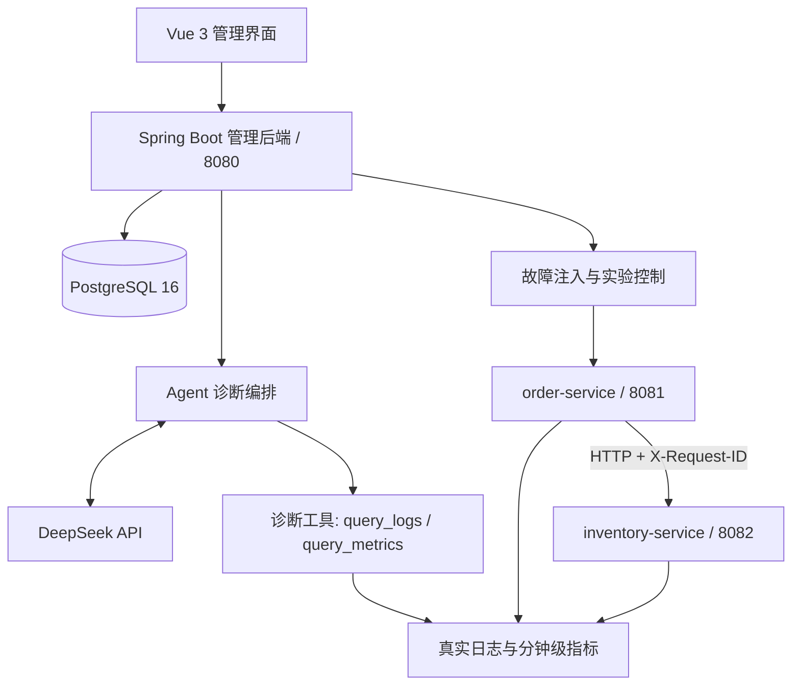
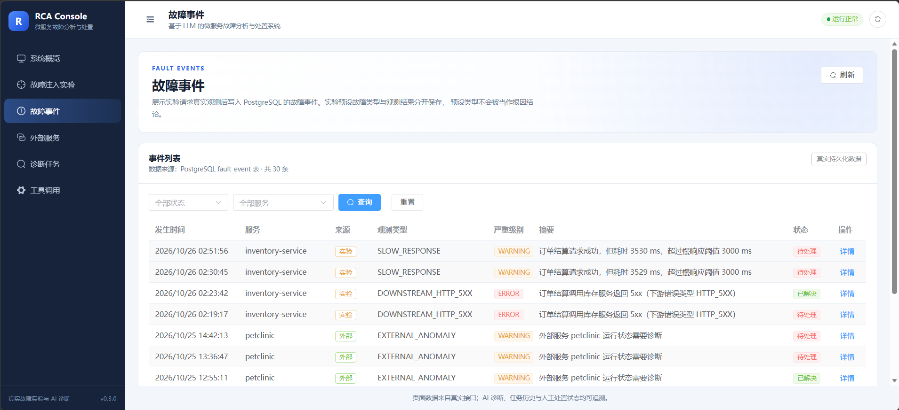
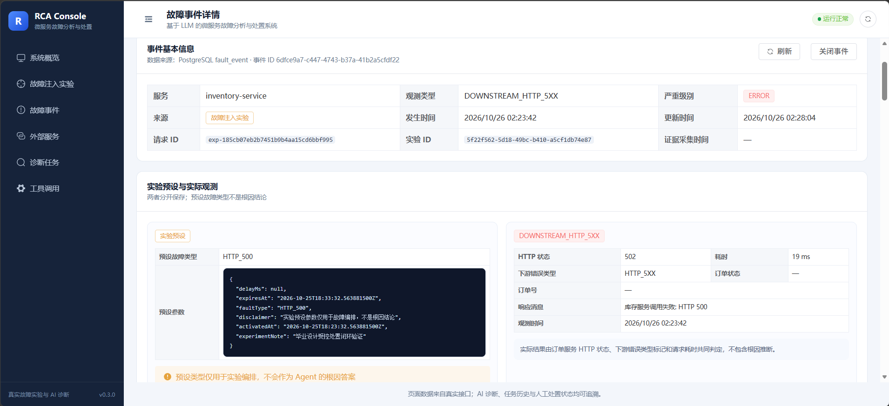
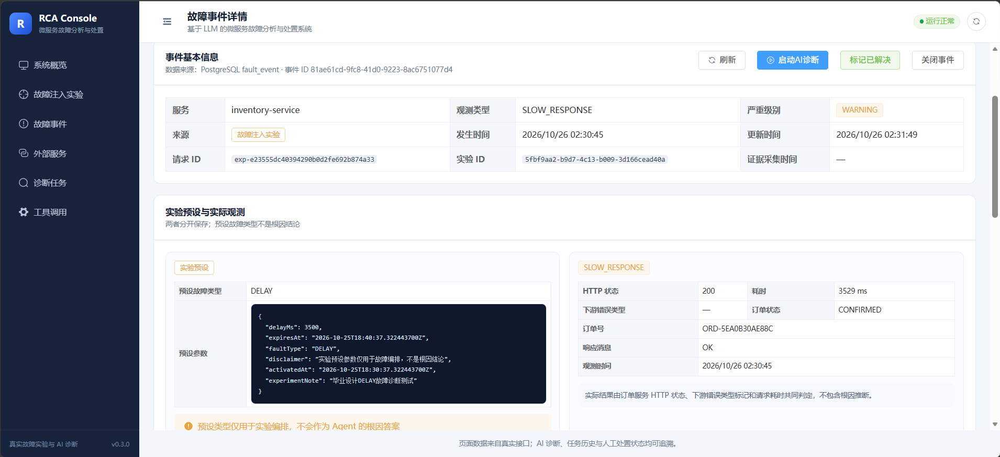
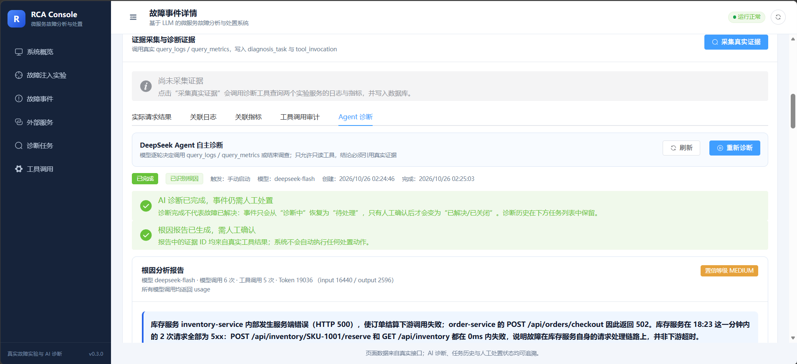
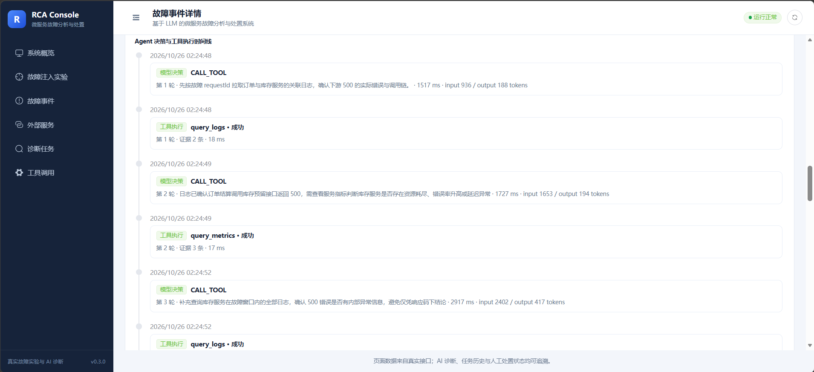
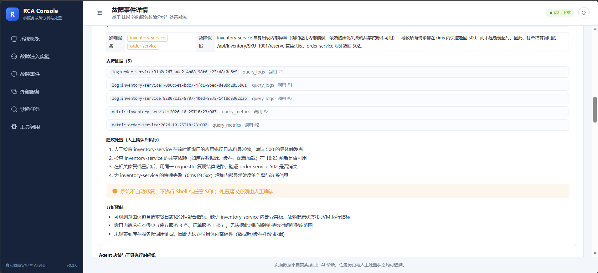
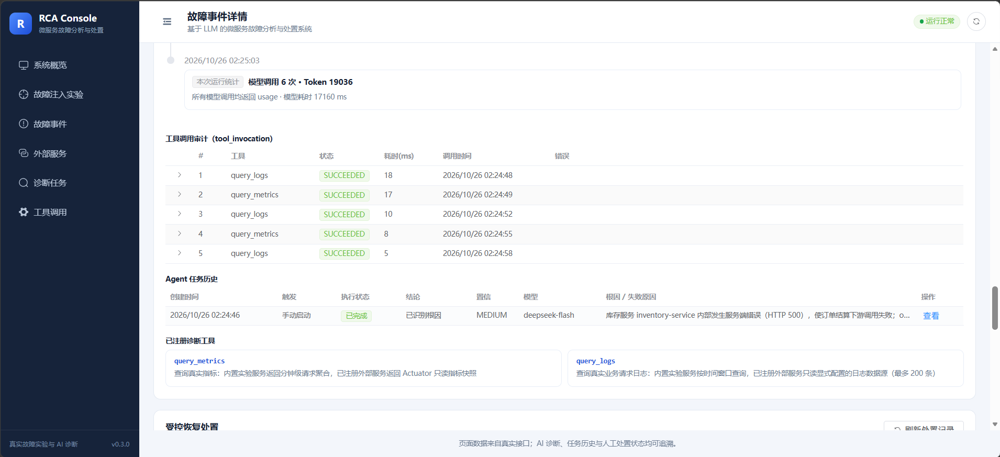
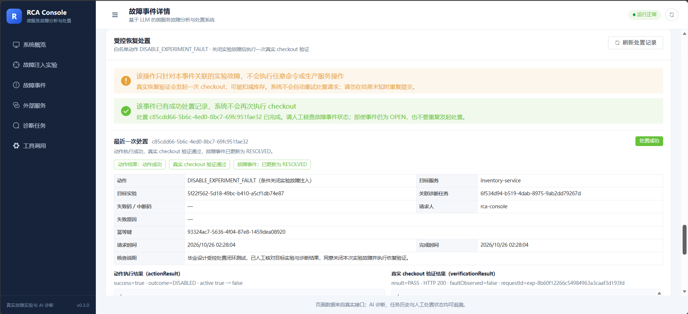
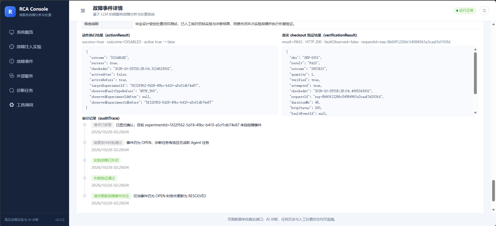

# 基于 LLM 的微服务故障分析与处置系统

> **Microservice RCA** · 本科毕业设计 · Java 后端 × LLM Agent × 微服务可观测性

基于 **Java 17、Spring Boot、DeepSeek API、Vue 3 和 PostgreSQL** 实现的微服务故障分析与处置实验系统。通过真实的订单—库存跨服务调用产生可观测数据，利用 LLM Agent 按需查询日志与指标，生成可追溯的故障根因报告及处置建议，并记录诊断、处置与恢复验证过程。

**项目定位：** 本地实验与教学演示系统，重点验证基于真实证据的 Agent 故障分析流程；不是开箱即用的生产级 AIOps 平台。

## 目录

- [项目亮点](#项目亮点)
- [系统架构](#系统架构)
- [系统演示](#系统演示)
- [技术栈](#技术栈)
- [快速启动](#快速启动)
- [故障实验与诊断](#故障实验与诊断)
- [测试与验证](#测试与验证)
- [工程结构与文档](#工程结构与文档)
- [安全与使用边界](#安全与使用边界)

## 项目亮点

| 能力 | 实现方式 |
| --- | --- |
| **Agent 自主诊断** | DeepSeek 逐轮决定调用 `query_logs`、`query_metrics` 或结束调查，而非固定顺序的工具流水线 |
| **真实跨服务证据** | `order-service` 通过 HTTP 调用 `inventory-service`；记录结构化日志、`X-Request-ID` 与分钟级指标 |
| **可追溯的根因分析** | 报告的 `supportingEvidenceIds` 必须对应真实工具结果；证据不足时明确返回 `INSUFFICIENT_EVIDENCE` |
| **受控工具执行** | 工具白名单、参数校验、重复调用处理，以及轮数、调用次数、超时和输出长度限制 |
| **异步任务与审计** | 诊断任务异步执行、轮询查询、保留历史任务与工具调用记录，支持失败后创建新任务重试 |
| **故障处置闭环** | 展示处置执行和恢复验证的结果与审计轨迹；AI 诊断完成不自动等同于故障已解决 |

## 系统架构



**一次诊断的典型过程：** 故障事件创建 → 异步诊断任务 → Agent 选择查询工具 → 获取日志/指标证据 → 继续调查或结束 → 校验证据引用 → 生成根因报告与处置建议 → 人工确认或执行受控处置、验证恢复。

> 诊断过程是动态的：工具调用顺序与次数由模型决策和执行预算共同决定。系统不把故障注入的预设类型直接作为模型的根因答案。

## 系统演示

以下截图来自项目实际运行界面，用于展示实验场景和功能，不代表生产环境部署。

### 1. 故障事件管理



### 2. HTTP 500 与 DELAY 故障观测

| HTTP 500 故障 | DELAY 故障 |
| --- | --- |
|  |  |

### 3. Agent 根因报告与决策时间线





### 4. 证据、工具审计与处置验证

| 证据与处置建议 | 工具调用审计 |
| --- | --- |
|  |  |

| 受控处置执行 | 恢复验证 |
| --- | --- |
|  |  |

## 技术栈

| 模块 | 技术 |
| --- | --- |
| 管理后端 | Java 17、Spring Boot 3.5.x、Spring Data JPA、Flyway |
| Agent 诊断 | DeepSeek API、自定义 Agent 编排、工具调用、结果校验与执行预算 |
| 实验微服务 | Java 17、Spring Boot 3.5.x、RestClient |
| 前端 | Vue 3、Vite、Element Plus、Vue Router、Axios |
| 数据库 | PostgreSQL 16 |
| 构建与运行 | Maven 3.9+、Node.js、npm、Docker Compose |

> Agent 采用项目内自定义编排逻辑，不依赖 LangChain 或 LangGraph。模型 ID 以实际 DeepSeek 账户可用列表为准。

## 快速启动

### 环境要求

- JDK 17、Maven 3.9+
- Node.js 20.19+ 或 22.12+、npm 10+
- Docker Desktop 与 Docker Compose
- 可选：DeepSeek API Key（真实 Agent 诊断必需）

以下命令以 **Bash / WSL / Git Bash** 为例；Windows CMD 中复制文件可用 `copy .env.example .env`，环境变量应直接写入根目录 `.env`。

### 1. 准备配置

在仓库根目录执行：

```bash
cp .env.example .env
```

按需修改 `.env` 中的 `POSTGRES_PASSWORD`、`DB_PASSWORD`（两者保持一致），并设置 `DEEPSEEK_API_KEY`。可用模型先通过 `GET /models` 验证，不要假定示例模型名称一定对当前账户有效。

根目录 `.env` 已被 Git 忽略；**不要将真实 Key、密码或含敏感信息的数据库导出文件提交到仓库**。

### 2. 启动 PostgreSQL

在仓库根目录执行：

```bash
docker compose --env-file .env -f infra/docker-compose.yml up -d
docker compose --env-file .env -f infra/docker-compose.yml ps
```

### 3. 启动后端与实验微服务

分别打开三个终端，从仓库根目录执行：

```bash
# 终端 A：管理后端（8080）
cd backend
mvn spring-boot:run
```

```bash
# 终端 B：库存服务（8082）
cd services/inventory-service
mvn spring-boot:run
```

```bash
# 终端 C：订单服务（8081）
cd services/order-service
mvn spring-boot:run
```

首次启动管理后端时，Flyway 会执行数据库迁移（V1、V2、V3）。健康检查：

```bash
curl http://localhost:8080/api/health
```

### 4. 启动前端

```bash
cd frontend
npm install
npm run dev
```

浏览器打开 **http://localhost:5173**。开发环境 `/api` 请求由 Vite 代理至 `http://localhost:8080`。

| 服务 | 默认端口 |
| --- | ---: |
| 前端 | 5173 |
| 管理后端 | 8080 |
| 订单服务 | 8081 |
| 库存服务 | 8082 |
| PostgreSQL | 5432 |

> 以上 `cd` 命令均以仓库根目录为起点；如在某个子目录中执行完命令，请先返回仓库根目录再启动下一个服务。WSL 中请使用 Linux 版 JDK 17；Docker Desktop 需要开启对应 WSL 集成。

## 故障实验与诊断

### 验证正常跨服务调用

```bash
curl -X POST http://localhost:8081/api/orders/checkout \
  -H 'Content-Type: application/json' \
  -d '{"sku":"SKU-1001","quantity":2}'
```

### 开启受控故障注入

默认禁用故障注入。仅在本地实验时，在 `.env` 中设置：

```dotenv
EXPERIMENT_FAULT_INJECTION_ENABLED=true
```

重启库存服务后，可通过前端“故障注入实验”页面，或使用管理后端 API：

```bash
curl -X POST http://localhost:8080/api/experiments/faults/enable \
  -H 'Content-Type: application/json' \
  -d '{"faultType":"DELAY","delayMs":3500,"durationSeconds":120,"note":"本地实验"}'
```

使用返回的 `experimentId` 执行实验：

```bash
curl -X POST 'http://localhost:8080/api/experiments/{experimentId}/execute' \
  -H 'Content-Type: application/json' \
  -d '{"sku":"SKU-1001","quantity":1}'
```

然后可在故障事件页面启动 DeepSeek Agent 诊断，查看工具调用时间线、证据和根因报告。实验结束后关闭故障：

```bash
curl -X POST http://localhost:8080/api/experiments/faults/disable
```

并将 `.env` 中 `EXPERIMENT_FAULT_INJECTION_ENABLED` 恢复为 `false`，重启库存服务。故障注入仅限本机实验地址，并带自动过期机制。

### 关键诊断接口

| 方法 | 接口 | 作用 |
| --- | --- | --- |
| `GET` | `/api/fault-events` | 查询故障事件 |
| `GET` | `/api/fault-events/{id}` | 事件详情及观测证据 |
| `POST` | `/api/fault-events/{id}/diagnosis` | 创建异步 Agent 诊断任务 |
| `GET` | `/api/diagnosis/tasks/{taskId}` | 查询任务状态、工具审计及报告 |
| `GET` | `/api/diagnosis/tasks?faultEventId={id}` | 查询事件诊断历史 |
| `POST` | `/api/diagnosis/tasks/{taskId}/retry` | 创建重试任务并保留历史 |
| `GET` | `/api/diagnosis/tools` | 查询已注册诊断工具 |
| `GET` | `/api/observability/logs` | 查询真实日志 |
| `GET` | `/api/observability/metrics` | 查询分钟级指标 |

## 测试与验证

项目分别验证真实模型调用、模拟模型单元测试和前端构建，不混用结果。

- **真实 DeepSeek 验证（Day 4）**：文档记录 12 次真实模型调用；HTTP_500 诊断耗时 **9.666 s**，DELAY 3500 ms 重试诊断耗时 **11.602 s**，两者均输出 `ROOT_CAUSE_IDENTIFIED`，证据 ID 均来自实际工具结果。
- **自动化测试（Day 5 基线）**：后端 63、库存服务 17、订单服务 7，共 **87 项测试通过**，前端构建成功。此为当时的验证记录，**不代表后续代码的最新测试总数**。
- **后续补充**：仓库包含 Agent 相关测试与 [诊断测试证据说明](docs/thesis-test-evidence.md)；最新测试结果应以当前代码重新执行为准。

本地运行测试：

```bash
(cd backend && mvn test)
(cd services/inventory-service && mvn test)
(cd services/order-service && mvn test)
(cd frontend && npm run build)
```

相关记录：[Day 4 真实模型验证](docs/plans/day4-deepseek-validation.md) · [Day 5 稳定化报告](docs/plans/day5-stabilization-report.md)

## 工程结构与文档

```text
microservice-rca/
├── backend/                       # 管理后端、Agent 编排、诊断 API
├── frontend/                      # Vue 管理界面
├── services/
│   ├── order-service/            # 订单实验服务
│   └── inventory-service/        # 库存实验服务与故障注入
├── infra/docker-compose.yml      # PostgreSQL 容器配置
├── docs/
│   ├── architecture/             # 系统架构设计
│   ├── images/                   # README 演示截图
│   └── plans/                    # 开发与验证报告
├── .env.example                   # 环境变量模板
└── README.md
```

更多资料：

- [系统架构设计](docs/architecture/system-design.md)
- [Day 4 联调与端到端验收](docs/plans/day4-integration-report.md)
- [Day 4 真实 DeepSeek 验证](docs/plans/day4-deepseek-validation.md)
- [Day 5 工程收尾报告](docs/plans/day5-stabilization-report.md)
- [答辩演示脚本](docs/plans/day5-demo-script.md)
- [诊断测试证据说明](docs/thesis-test-evidence.md)

## 安全与使用边界

- **模型调用不等于故障解决**：Agent 完成诊断后，故障事件仍需人工确认；`RESOLVED` / `CLOSED` 不应由诊断结果自动推断。
- **证据真实性**：日志与指标来自实验服务的真实请求；故障预设不作为根因答案；证据不足时明确给出相应状态。
- **模型不可用时不伪造结果**：未配置 API Key 或模型调用失败时，诊断任务明确失败。
- **演示环境限制**：库存样例数据与部分观测缓存为本地实验用途；故障注入功能不得直接暴露到公网或生产环境。
- **敏感信息**：不要提交 `.env`、真实 API Key、数据库凭据或未经审查的数据库数据导出；截图发布前检查是否包含敏感内容。

---

*本项目为本科毕业设计与工程实践项目，重点展示微服务可观测性、LLM Agent 工具调用、证据约束诊断与受控处置流程。*
