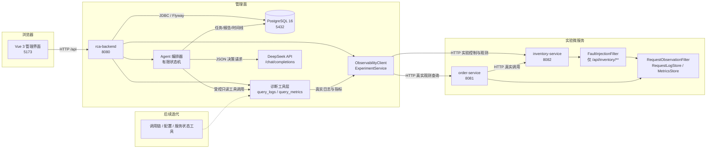
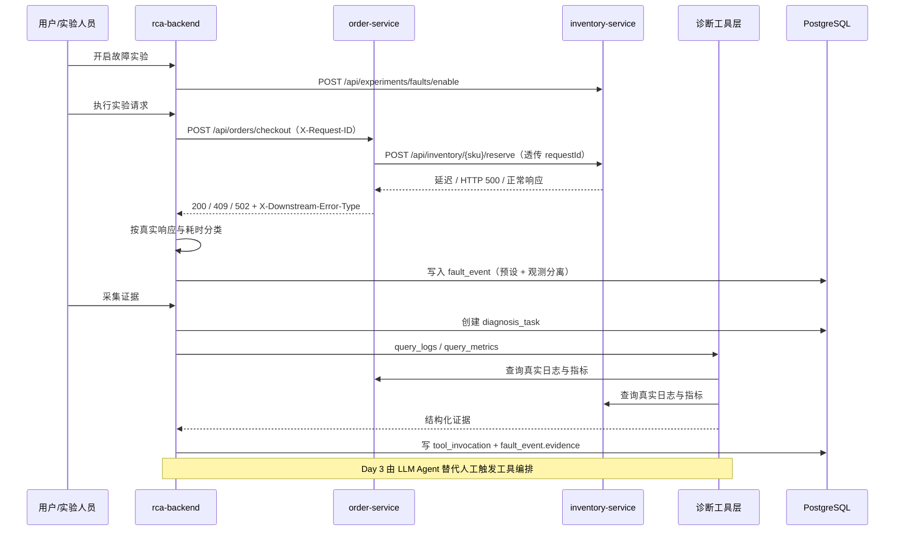
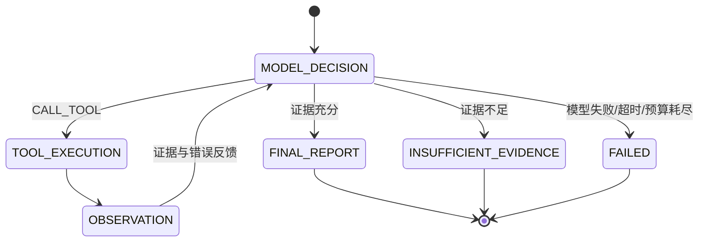

# 基于 LLM 的微服务故障分析与处置系统 — 系统设计

| 项目 | 内容 |
| --- | --- |
| 文档版本 | v0.4.0（Day 5 工程收尾） |
| 日期 | 2026-10-22 |
| 范围 | 总体架构、故障注入、可观测性、诊断工具、证据链、DeepSeek Agent、数据模型、安全边界 |
| 状态 | Day 4 已完成真实 DeepSeek 调用的 HTTP_500 / DELAY 端到端验收；Day 5 完成事件与任务状态语义修正、逐轮 usage 核算、测试回归与答辩演示准备 |

## 1. 系统目标

构建一个可运行、可验证、可持续扩展的微服务故障诊断系统，形成以下闭环：

1. 通过故障注入在实验微服务中制造**真实**异常。
2. 采集日志、指标、调用链等**真实**观测数据。
3. 由 LLM Agent 动态规划并调用诊断工具，提出故障假设。
4. 对假设进行验证，形成带证据链的根因结论。
5. 输出辅助处置建议，并由人工确认后执行。
6. 记录全过程，支持复盘与论文实验复现。

### 非目标（当前阶段）

- 不建设通用监控平台，不替代 Prometheus / SkyWalking。
- 不引入 Kubernetes、Kafka、ELK 等重型组件。
- 不实现自动处置执行；处置建议必须人工确认。
- 不展示任何虚构的监控指标或 AI 分析结果。
- 不创建子 Agent、不执行 Shell/任意 SQL/任意 HTTP 请求。
- 当前阶段不扩展更多实验故障类型，不引入 Kubernetes、Kafka、ELK 等重型组件。

## 2. 总体架构



### 架构原则

- **管理面与实验面分离**：管理后端负责事件、任务、证据与展示；实验服务只承载业务、故障注入与请求观测。
- **真实优先**：所有展示数据必须来自真实接口；未实现能力明确标记“待开发”。
- **预设与观测分离**：实验预设故障类型只用于实验编排，不能作为根因结论。
- **接口先行**：Agent 与工具层先定义稳定契约，后续替换实现不影响上层。
- **安全默认**：故障注入默认关闭、仅本机实验地址、自动过期、作用域受限。
- **可复现**：数据库结构版本化（Flyway），启动命令、实验步骤与验证结果文档化。

## 3. 模块职责

| 模块 | 职责 | 当前状态 |
| --- | --- | --- |
| `frontend` | 概览、故障注入、故障事件、事件详情、Agent 任务与工具调用界面 | 已完成 |
| `backend` | 统一 API、事件管理、证据采集、工具注册与审计、实验代理、Agent 编排 | 已完成 |
| `order-service` | 订单实验服务，真实调用库存服务，记录请求观测 | 已完成 |
| `inventory-service` | 库存实验服务，故障注入，记录请求观测 | 已完成 |
| `infra` | PostgreSQL 容器与本地基础设施 | 已完成 |
| 故障注入 | 延迟、HTTP 500 两种真实故障 | 已完成（Day 2） |
| 观测采集 | 结构化请求日志、requestId 透传、分钟级指标 | 已完成（Day 2） |
| 工具层 | `query_logs`、`query_metrics` | 已完成（Day 2） |
| Agent 编排 | 模型逐轮选择工具、观察结果、形成证据约束报告 | 已完成（Day 3，Day 4 真实模型验收） |
| 状态与用量 | 事件/任务状态语义、诊断历史保留、逐轮 usage 与耗时核算 | 已完成（Day 5） |
| 处置执行 | 人工确认后的恢复动作 | 仅展示建议，不自动执行 |

## 4. 服务通信

| 调用方 | 被调用方 | 协议 | 说明 |
| --- | --- | --- | --- |
| 浏览器 | rca-backend | HTTP/JSON | 开发环境经 Vite 代理 `/api` |
| rca-backend | PostgreSQL | JDBC | HikariCP，Flyway V1/V2/V3 |
| rca-backend | order-service | HTTP/JSON | 真实结算、观测查询 |
| rca-backend | inventory-service | HTTP/JSON | 实验控制、库存查询、观测查询 |
| order-service | inventory-service | HTTP/JSON | `RestClient`，2s 连接 / 5s 读取超时 |
| Agent 编排器 | DeepSeek API | HTTPS/JSON | `/chat/completions`，JSON 输出模式，默认模型 `deepseek-flash`，Key 仅来自环境变量 |
| Agent 编排器 | 工具层 | 进程内接口 | 白名单、只读、超时、完整审计 |
| 工具层 | 实验服务 | HTTP/JSON | 只读观测查询，最多 24 小时窗口 |

### 端口与部署

| 组件 | 端口 |
| --- | --- |
| frontend | 5173 |
| rca-backend | 8080 |
| order-service | 8081 |
| inventory-service | 8082 |
| PostgreSQL | 5432 |

## 5. 故障注入设计

### 5.1 故障类型

| 类型 | 参数 | 行为 | 边界 |
| --- | --- | --- | --- |
| `DELAY` | `delayMs` | 在库存业务接口处理前等待指定毫秒 | 1–30000 ms，可被线程中断 |
| `HTTP_500` | 无 | 直接返回统一错误结构 HTTP 500 | 不进入业务逻辑 |

### 5.2 控制接口

| 方法 | 路径 | 说明 |
| --- | --- | --- |
| GET | `/api/experiments/faults` | 查询实验开关、当前故障与过期时间 |
| POST | `/api/experiments/faults/enable` | 开启故障，返回 `experimentId` |
| POST | `/api/experiments/faults/disable` | 立即关闭当前故障 |
| POST | `/api/experiments/faults/reset` | 清空实验状态 |

### 5.3 安全边界

- **默认禁用**：`experiment.fault-injection.enabled=false`；关闭时启用返回 403。
- **访问限制**：`ExperimentAccessGuard` 校验来源地址，默认仅允许 `127.0.0.1` / `::1`。
- **自动过期**：每次开启必须设置 1–600 秒持续时间，默认 120 秒；读取状态时惰性清理过期故障。
- **作用域受限**：`FaultInjectionFilter` 仅匹配 `/api/inventory/**`；`/api/health`、`/api/observability/**`、`/api/experiments/**` 不受影响。
- **不会永久阻塞**：延迟有最大值，`Thread.sleep` 可被中断；所有故障均可关闭/重置。
- **不写业务数据**：故障状态只存在于库存服务内存，不修改数据库与库存数据。

### 5.4 实验请求链路

管理后端 `POST /api/experiments/{experimentId}/execute` 生成 `requestId`，经订单服务发起真实结算；订单服务调用库存服务时透传 `X-Request-ID`。管理后端以实测 HTTP 状态、下游错误标记与耗时判定观测结果，而不是直接使用预设故障类型。

## 6. 可观测性设计

### 6.1 请求日志

`RequestObservationFilter` 在订单与库存服务中记录业务请求：

| 字段 | 说明 |
| --- | --- |
| `id` | 日志记录 ID |
| `timestamp` | 请求开始时间（UTC） |
| `serviceName` | `order-service` / `inventory-service` |
| `requestId` | `X-Request-ID`，缺失时生成 32 位 ID |
| `method` / `path` | HTTP 方法与业务路径 |
| `status` | 真实响应状态码 |
| `durationMs` | 请求处理耗时 |
| `errorType` | 归一化错误类型 |

`errorType` 取值包括：`NONE`、`HTTP_4XX`、`HTTP_5XX`、`BUSINESS_CONFLICT`、`DOWNSTREAM_TIMEOUT`、`DOWNSTREAM_HTTP_5XX`、`UNHANDLED_EXCEPTION` 等。

存储采用双通道：

- 有界内存环形存储（默认 5000 条），供工具实时查询。
- Logback 滚动 JSONL 文件（单文件 10 MB、保留 3 份、总量 50 MB），供人工复核。

### 6.2 请求指标

`RequestMetricsStore` 按分钟聚合真实请求：

- `requestCount`
- `serverErrorCount`（5xx）
- `clientErrorCount`（4xx，含 409 业务冲突）
- `totalDurationMs` / `maxDurationMs`
- 派生平均耗时

默认保留 180 分钟，按时间窗口查询，不生成随机或静态数据。

### 6.3 查询接口

| 方法 | 路径 | 参数 | 限制 |
| --- | --- | --- | --- |
| GET | `/api/observability/logs` | `startTime`、`endTime`、`requestId`、`limit` | 窗口 ≤ 24h，`limit` 1–200，默认 15 分钟 |
| GET | `/api/observability/metrics` | `startTime`、`endTime` | 窗口 ≤ 24h，默认 15 分钟 |

响应包含 `source`（数据来源）、`serviceName`、`collectedAt`、查询窗口与实际数据。

## 7. 诊断工具与证据

### 7.1 工具契约

```java
public interface DiagnosticTool {
    String name();
    String description();
    ToolResult execute(ToolExecutionContext context);
}
```

`ToolExecutionContext` 包含诊断任务 ID、目标服务、时间窗口与参数；`ToolResult` 包含成功标志、结构化输出与错误信息。

### 7.2 已实现工具

| 工具 | 输入 | 输出 | 约束 |
| --- | --- | --- | --- |
| `query_logs` | 服务、时间窗、`requestId`、`limit` | 合并后的日志条目、来源、证据 ID | 只读，≤ 200 条 |
| `query_metrics` | 服务、时间窗 | 服务级分钟桶与全局汇总 | 只读，窗口 ≤ 24h |

后续候选：`query_traces`、`query_service_status`、`query_config_diff`、`verify_hypothesis`。

### 7.3 调用审计与证据链

- `DiagnosticToolRegistry` 按名称注册工具，`GET /api/diagnosis/tools` 返回定义。
- `ToolInvocationService` 每次调用写入 `tool_invocation`：工具名、输入、输出、状态、耗时、顺序、错误信息。
- 证据采集先创建真实 `diagnosis_task`（`MANUAL_EVIDENCE`），再调用工具，保证外键真实。
- 证据快照写入 `fault_event.evidence`，包含任务 ID、时间窗口、requestId、工具输出与采集时间。
- 每个工具输出包含 `dataSources`、`timeRange`、`collectedAt`、`evidenceIds`，可追溯到原始记录。

## 8. 故障诊断链路



### 证据链要求

- 每条证据必须可追溯到具体工具调用、时间窗口与原始记录 ID。
- 根因结论需关联至少一条支持证据；被反驳的假设也保留记录。
- LLM 输出只作为建议，不作为系统事实；置信度与不确定性显式展示。
- Agent 输入不得包含实验预设故障类型，避免“预设即答案”。

### 8.1 Agent 编排状态机

Day 3 采用清晰的有限状态编排器，而不是固定“调用两个工具后生成报告”的流水线：



**技术选型取舍**：LangGraph4j 1.8.4 在 Java 17 下可用，但当前流程只有一个受预算约束的单循环，不需要图检查点、并行分支或多 Agent 协作。引入图框架及传递依赖会增加答辩演示的构建与调试风险，因此选择显式有限状态机实现，并在接口层保持可替换，后续需要复杂图编排时可迁移。

### 8.2 Agent 白名单输入

`AgentInputFactory` 只构造以下白名单字段：

- 事件 ID、服务名、事件类型、严重级别、摘要、requestId；
- 真实观测结果中的 `outcome`、`httpStatus`、`durationMs`、`downstreamErrorType`、`orderStatus`、`responseMessage`、`transportError`、`observedAt`；
- 时间窗口、可用工具定义、预算限制。

`experimentFaultType`、`experimentParameters`、`details` 等实验预设或内部上下文不会进入模型提示词；即使 `observed_result` 中意外混入预设字段，也会被再次过滤。该约束由单元测试捕获实际请求并断言字段不存在。

### 8.3 模型输出、工具与报告校验

| 环节 | 校验 |
| --- | --- |
| 模型输出 | 必须是单个 JSON 对象，`action` 只能是 `CALL_TOOL` / `FINAL_REPORT` / `INSUFFICIENT_EVIDENCE`；输出长度受限 |
| 工具选择 | 必须来自 `DiagnosticToolRegistry` 且属于 Agent 允许清单；未注册工具拒绝 |
| 工具参数 | 只允许白名单键；服务范围固定；`lookbackMinutes` 1–60、`limit` 1–200；`requestId` 字符集与长度受限 |
| 重复调用 | 相同工具 + 范围 + 参数签名只执行一次，后续拒绝并反馈模型 |
| 最终报告 | 必需字段、长度、服务名、置信等级严格校验；支持/反驳证据必须同时存在于真实工具结果，且不能重叠 |
| 证据不足 | 输出 `INSUFFICIENT_EVIDENCE`，不写 `root_cause`、不写置信度 |
| 工具失败 | 作为失败观察反馈给模型，不转换为根因；模型仍可结束为证据不足 |

工具执行统一经过 `ToolInvocationService`，每次真实调用写入 `tool_invocation`，包含输入、输出、状态、耗时、顺序和错误。

### 8.4 预算、超时与失败处理

| 限制 | 默认值 | 上限 |
| --- | --- | --- |
| 最大模型调用轮数 | 6 | 12 |
| 最大工具调用次数 | 6 | 12 |
| 单次模型输出字符数 | 12000 | 50000 |
| 提示词字符数 | 60000 | 120000 |
| 单次工具结果进入提示词字符数 | 6000 | 30000 |
| 整体超时 | 180 秒 | 600 秒 |

模型 401/402/403 视为不可重试的鉴权或余额问题；429/5xx/网络超时作为可重试错误占用下一轮模型预算，不无限重试，且每次尝试都计入模型轮数并受整体超时约束。任务最终失败时记录 `failure_reason` 与错误时间线，任务可重试；重试创建新任务，保留原任务审计记录。未配置 `DEEPSEEK_API_KEY` 时直接失败，不调用模型、不生成结论。

**usage 与耗时核算**：每一次模型调用（包括被接受后执行工具的轮次、工具被拒绝的轮次和失败轮次）都在 `decision_trace` 中生成独立记录。Provider 返回 `usage` 时，记录 `promptTokens`、`completionTokens`、`totalTokens` 与 `usageAvailable=true`；未返回时 `usageAvailable=false`、Token 字段为 `null`，并附 `usageNote` 明示缺失，不补零冒充真实消耗。任务终态追加一条 `AGENT_RUN_SUMMARY`，汇总模型调用次数、有/无 usage 的轮数、可获取的 Token 合计和模型耗时；根因报告与证据不足报告也嵌入同一组统计字段。

### 8.5 任务状态与结论状态

- 任务执行状态：`PENDING → RUNNING → SUCCEEDED / FAILED`。
- 诊断结论状态（仅 `SUCCEEDED` 时存在）：`ROOT_CAUSE_IDENTIFIED` / `INSUFFICIENT_EVIDENCE`。
- 两者分列存储，避免把“执行成功但证据不足”误报为根因，也避免把模型失败误报为证据不足。
- 故障事件状态表示**处置生命周期**，不是诊断结果：任务启动时 `OPEN → DIAGNOSING`；任务进入任意终态后 `DIAGNOSING → OPEN`，等待人工处置；`RESOLVED` / `CLOSED` 只能由人工确认，AI 诊断完成不会自动把事件标记为已解决。
- 每次启动/重试都创建新的 `diagnosis_task`，不覆盖既有成功或失败记录，任务列表即诊断历史。

## 9. 数据流

1. **实验流**：开启故障 → 真实请求 → 订单/库存观测 → 管理后端分类 → 写入 `fault_event`。
2. **证据流**：事件 → 创建 `diagnosis_task` → 工具查询真实日志/指标 → `tool_invocation` → 证据快照。
3. **展示流**：管理后端聚合事件、预设、观测与证据 → 前端展示。
4. **Agent 诊断流**：读取白名单事件 → 模型逐轮决策 → 调用只读工具 → 观察结果/错误 → 生成证据约束报告或证据不足 → 保存报告、时间线、工具审计。
5. **处置流（后续）**：人工确认 → 处置记录 → 事件关闭；当前仅展示建议，不自动执行。

## 10. 数据库设计

### 10.1 V1 基础表

- `fault_event`：服务、事件类型、严重级别、摘要、详情、状态、发生时间。
- `diagnosis_task`：关联事件、状态、触发来源、目标、结论、根因、置信度。
- `tool_invocation`：关联任务、工具名、输入输出、状态、耗时、顺序。

### 10.2 V2 迁移（Day 2）

`V1__init_schema.sql` 不修改，新增 `V2__fault_event_experiment_evidence.sql`：

| 字段 | 类型 | 说明 |
| --- | --- | --- |
| `experiment_id` | UUID | 关联故障注入实验 |
| `experiment_fault_type` | VARCHAR(64) | 实验预设故障类型，不作为根因 |
| `experiment_parameters` | JSONB | 实验参数快照 |
| `observed_result` | JSONB | 真实请求观测结果 |
| `request_id` | VARCHAR(64) | 跨服务请求关联 |
| `source` | VARCHAR(32) | `MANUAL` / `EXPERIMENT` |
| `evidence` | JSONB | 工具采集证据快照 |
| `evidence_collected_at` | TIMESTAMPTZ | 证据采集时间 |
| `updated_at` | TIMESTAMPTZ | 更新时间 |
| `resolved_at` | TIMESTAMPTZ | 解决时间 |

约束与索引：

- `ck_fault_event_source CHECK (source IN ('MANUAL','EXPERIMENT'))`
- `idx_fault_event_request_id`
- `idx_fault_event_experiment_id`
- `idx_fault_event_occurred_at`

### 10.3 V3 迁移（Day 3）

`V1`、`V2` 均不修改，新增 `V3__agent_diagnosis.sql`：

| 字段 | 类型 | 说明 |
| --- | --- | --- |
| `result_status` | VARCHAR(32) | `ROOT_CAUSE_IDENTIFIED` / `INSUFFICIENT_EVIDENCE`，与任务执行状态分离 |
| `confidence_level` | VARCHAR(16) | `HIGH` / `MEDIUM` / `LOW` |
| `failure_reason` | VARCHAR(1024) | 模型失败、超时、余额不足、校验失败等可审计原因 |
| `report` | JSONB | 经过证据 ID 校验的结构化报告或证据不足说明 |
| `agent_input` | JSONB | 白名单输入快照 |
| `decision_trace` | JSONB | 模型决策摘要、工具执行、耗时与错误时间线 |
| `model_name` | VARCHAR(128) | 实际模型名，不记录 Key |
| `started_at` | TIMESTAMPTZ | Agent 开始执行时间 |

约束与索引：

- `ck_diagnosis_task_result_status`：只允许两种结论状态或 NULL。
- `ck_diagnosis_task_confidence_level`：只允许三档定性置信度或 NULL。
- `idx_diagnosis_task_result_status`
- `idx_diagnosis_task_created_at`

`tool_invocation` 复用既有表，不新增列；Agent 的每次工具调用仍按顺序写入。

### 10.4 状态流转

`fault_event.status`：

- `OPEN → DIAGNOSING / RESOLVED / CLOSED`
- `DIAGNOSING → OPEN`（诊断任务进入终态后由 `AgentTaskRunner` 内部恢复，不通过人工状态接口暴露）
- `DIAGNOSING → RESOLVED / CLOSED`
- `RESOLVED → CLOSED`
- `CLOSED` 不再流转

状态变更同步更新 `updated_at`，解决时写入 `resolved_at`。`DIAGNOSING → OPEN` 表示“诊断结束，等待人工处置”，不代表故障已恢复；恢复后事件仍需人工标记为 `RESOLVED`。

## 11. API 约定

统一响应结构：

```json
{
  "code": 200,
  "message": "OK",
  "data": {},
  "timestamp": "2026-10-21T00:00:00Z"
}
```

- 成功：`code = 200`；参数错误：400；资源不存在：404；业务冲突：409；下游不可用：502；未知错误：500。
- 健康检查返回真实数据库连通性与耗时，数据库异常时整体状态为 `DEGRADED`。
- 订单服务对库存不足返回 409；对下游超时/5xx 返回 502，并附带 `X-Downstream-Error-Type`。
- 错误信息不返回堆栈与敏感配置。

### 11.1 Agent 诊断接口

| 方法 | 路径 | 说明 |
| --- | --- | --- |
| POST | `/api/fault-events/{eventId}/diagnosis` | 创建并异步启动诊断任务，立即返回任务详情 |
| GET | `/api/diagnosis/tasks/{taskId}` | 任务状态、结论状态、报告、白名单输入、决策时间线、工具调用 |
| GET | `/api/diagnosis/tasks?faultEventId={eventId}` | 事件的任务历史（按创建时间倒序） |
| POST | `/api/diagnosis/tasks/{taskId}/retry` | 对非运行中任务创建重试任务，原任务保留 |

同一事件存在 `PENDING` / `RUNNING` 任务时，重复启动返回 409。任务详情中的 `status` 与 `resultStatus` 分开返回。

## 12. 安全与数据真实性

- 故障注入默认禁用，仅本地实验环境启用；启用需要显式开关与回环地址。
- 实验状态可关闭、可重置、自动过期，不修改业务数据。
- 库存不足是业务冲突，不记为系统故障。
- 预设故障类型与实际观测结果分字段保存；前端明确标注预设不是根因。
- 指标与日志只来自真实业务请求，不使用随机数或静态 JSON。
- 观测存储有界：日志最多 5000 条，指标保留 180 分钟，查询窗口最多 24 小时。
- Agent 只读优先，处置动作必须人工确认；不实现自动修复、Shell 或任意 SQL 工具。
- DeepSeek API Key 只从环境变量读取，禁止硬编码、打印或写入仓库/数据库。
- Agent 输入白名单化，实验预设字段不进入模型；最终报告必须通过真实证据 ID 校验。
- 模型调用与工具调用均有轮数、次数、超时和长度上限，避免无限循环与意外费用。
- 模型失败、超时、余额不足、输出非法均记录为任务失败或可重试错误，不伪造诊断结论。

## 13. 风险与缓解

| 风险 | 影响 | 缓解措施 |
| --- | --- | --- |
| 预设故障类型泄漏为“根因” | 诊断结论失真 | 分字段存储、UI 标注、Day 3 Agent 输入剔除 |
| LLM 幻觉导致错误根因 | 结论不可信 | 强制证据链、假设验证、人工确认、置信度 |
| 观测数据重启丢失 | 证据不可追溯 | JSONL 滚动文件保留；后续增加文件回放/外部存储 |
| 内存占用无限增长 | 服务不稳定 | 日志容量上限、指标保留期、查询窗口上限 |
| 故障未关闭或永久阻塞 | 业务不可用 | 自动过期、最大延迟、可中断、关闭/重置 |
| 实验接口被非授权访问 | 安全风险 | 默认禁用、回环白名单、仅本地环境 |
| 演示环境依赖 Docker/WSL | 现场启动失败 | 提前演练、文档化命令、准备降级步骤 |
| 范围蔓延 | 无法按时完成 | 严格按 Day 计划推进，非目标明确排除 |
| 工具调用越权或破坏数据 | 安全风险 | 只读优先、白名单、超时、审计、人工确认 |
| API 成本与限流 | 演示不稳定 | 模型轮数/工具次数/超时/输出长度上限，429/5xx 可重试但受轮数与超时约束 |
| DeepSeek Key 泄漏 | 安全风险 | 仅环境变量注入，不打印、不入库、不写仓库 |
| 模型编造证据 ID | 结论失真 | 报告校验只接受真实工具输出中的 `evidenceIds`，否则拒绝并反馈模型 |
| 任务执行与结论混淆 | 展示误导 | `status` 与 `resultStatus` 分列，证据不足不写根因 |
| 模型不可用或余额不足 | 演示中断 | 明确失败原因、任务可重试、提前检查环境与代理 |
| 模型名称/接口过期 | 真实调用失败 | 默认模型更新为当前官方 `deepseek-flash`，联调前用最小请求核对接口与模型名 |

## 14. 演进路线

- **Day 1**：工程初始化、三服务联通、V1 表结构、基础页面。✅
- **Day 2**：真实故障注入、故障事件与证据、日志/指标、`query_logs` / `query_metrics`、前端业务页面。✅
- **Day 3**：DeepSeek Agent 编排、白名单事件输入、模型驱动工具选择、证据约束根因报告、诊断任务与前端时间线。✅
- **Day 4**：真实 DeepSeek 模型接入，HTTP_500 与 DELAY 均完成真实 Agent 自主诊断、证据链与前端验证。✅
- **Day 5**：工程收尾——事件/任务状态语义修正、逐轮 usage 与耗时核算、全量测试、敏感信息检查、5 分钟答辩演示脚本与真实截图规划。✅
- **Day 6–7**：正式演示、实验评测与论文材料。
